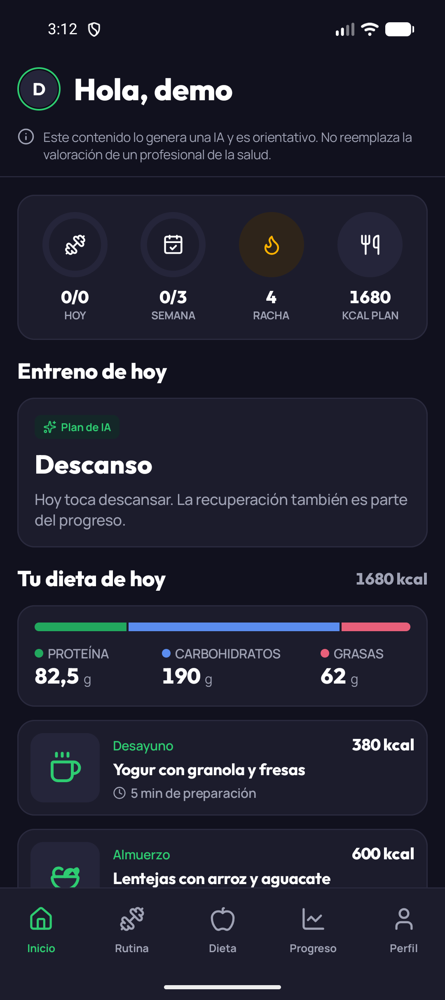
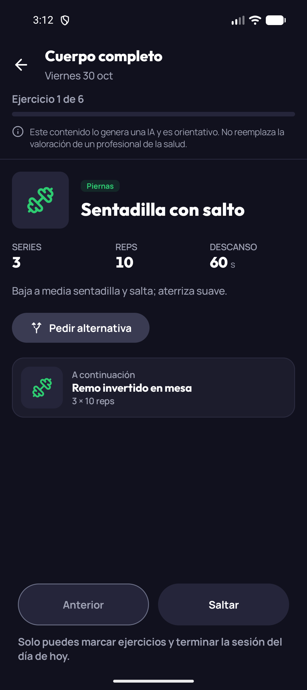
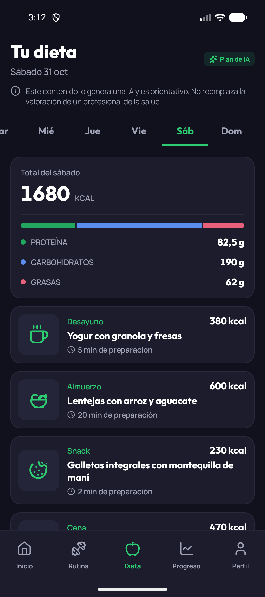
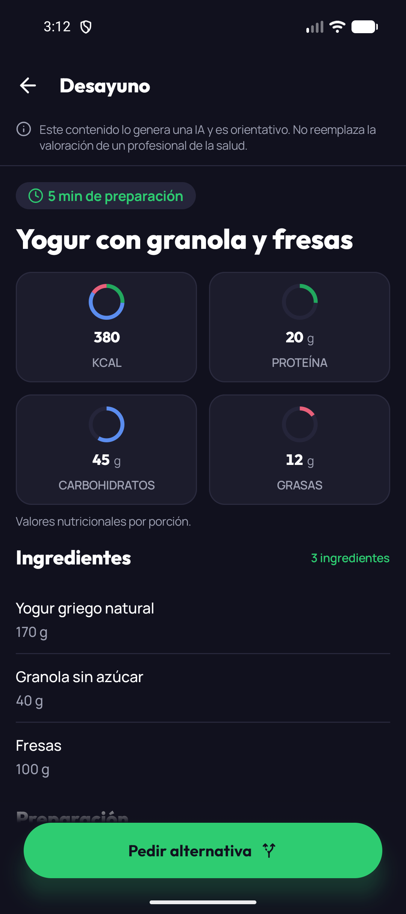

# AllFitness

App Android que genera con IA una **rutina de ejercicio semanal** y un **plan de alimentación con recetas**, personalizados según los datos físicos, el objetivo, el nivel, el equipo disponible, el tipo de dieta, las alergias y los gustos de cada persona.

Está pensada para adultos principiantes o de nivel intermedio en Colombia y Latinoamérica que entrenan en casa o en un gimnasio básico. La persona sigue su rutina, consulta su dieta, pide alternativas cuando algo no le sirve (por ejemplo, "no tengo el equipo" o "no tengo los ingredientes") y registra su progreso.

> El contenido generado es orientativo y no reemplaza a un profesional de salud. La app lo indica en todas las pantallas con contenido de IA.

<p>
  
  
  
  
</p>

## Funcionalidades

| Pantalla | Qué hace |
|---|---|
| **Registro y onboarding** | Registro con aceptación de términos y un cuestionario de 4 pasos que se puede retomar. Al terminar, la IA genera la rutina y la dieta (hasta unos 60 s). |
| **Inicio** | Resumen del día: ejercicios y sesiones de la semana, racha, kcal del plan, el entreno de hoy, las comidas de hoy y el progreso semanal. |
| **Rutina** | La semana con hoy destacado y los días de descanso. Cada ejercicio muestra series, repeticiones o duración y descanso. |
| **Modo sesión** | Un ejercicio por página: marcar como hecho, saltar, volver y terminar la sesión. Solo se marca el día actual y con conexión. |
| **Dieta y receta** | Los 7 días con kcal y macros. Cada receta tiene ingredientes, pasos y tiempo de preparación. |
| **Alternativas** | Pedir otro ejercicio u otra receta indicando el motivo, o regenerar la rutina o la dieta completas. El contenido actual sigue visible hasta que llega el nuevo. |
| **Progreso** | Sesiones completadas, racha en semanas y gráfica de evolución del peso con su historial. |
| **Perfil** | Editar los datos por sección (y regenerar el plan si se quiere), política de privacidad, cerrar sesión y eliminar la cuenta. |

Funciona **sin conexión**: rutina, dieta y último progreso se consultan desde la caché, con un aviso de que pueden no estar actualizados.

## Stack

- Kotlin y Jetpack Compose con Material 3, en un único tema oscuro.
- Hilt para la inyección de dependencias y Navigation Compose para la navegación.
- Retrofit para la red, Room como caché local y DataStore para la sesión y los borradores.
- Coil para imágenes, Vico para gráficas, core-splashscreen y material3-adaptive-navigation-suite (barra inferior en teléfonos, riel lateral en pantallas anchas).
- minSdk 26, targetSdk 37, JDK 17.

La app es **solo frontend**: el backend calcula todo (calorías, macros, rachas y progresiones) y genera el contenido con IA. La app muestra y da formato.

## Cómo ejecutarla

Requisitos: Android Studio (última versión estable) con JDK 17 y un emulador o dispositivo con Android 8.0 (API 26) o superior.

El proyecto tiene dos *flavors*:

| Flavor | Backend | Uso |
|---|---|---|
| `mock` | `FakeBackend` en memoria, con datos de ejemplo | Desarrollo y pruebas sin servidor. Id: `com.allfitness.app.mock`. |
| `real` | La API real | Configura la URL en `local.properties`. |

```bash
# App con datos de ejemplo
./gradlew installMockDebug

# Tests unitarios y lint
./gradlew testMockDebugUnitTest
./gradlew lintMockDebug
./gradlew lintRealDebug

# Contra el backend real
./gradlew installRealDebug
```

Para el flavor `real`, añade a `local.properties` (no se sube al repositorio):

```properties
allfitness.baseUrl=https://tu-backend.example/
```

### Probar con el flavor `mock`

Cualquier correo y contraseña válidos inician sesión. Hay una cuenta de ejemplo con datos: `demo@allfitness.co`. El Fake guarda las marcas, los pesos y el perfil en memoria hasta que se cierra la app.

Algunos valores provocan estados especiales:

| Para provocar | Haz esto |
|---|---|
| Correo ya registrado (409) | Regístrate con `existe@allfitness.co` |
| Credenciales incorrectas (401) | Inicia sesión con la contraseña `Incorrecta1` |
| IA lenta (~55 s) | Escribe `#lento` en el comentario de una alternativa o regeneración |
| La IA falla | Escribe `#falla` en el comentario |
| Falla la dieta al terminar el onboarding | Escribe `#sindieta` en "alimentos que no te gustan" |
| Sesión expirada | Registra un peso de `299.9` kg |
| Respuesta incompleta | Pide una alternativa de receta con `#roto` |

El recorrido completo de verificación está en [`specs/001-allfitness-mvp/quickstart.md`](specs/001-allfitness-mvp/quickstart.md).

## Estructura del proyecto

```
app/src/
├── main/java/com/allfitness/app/
│   ├── core/
│   │   ├── ui/theme/   colores, tipografía, formas, espacios y animación
│   │   ├── ui/         componentes compartidos (botones, tarjetas, anillos, formularios…)
│   │   ├── network/    interceptor, conectividad y llamadas seguras
│   │   ├── database/   caché local (Room)
│   │   └── session/    sesión del usuario
│   ├── auth/           login y registro
│   ├── onboarding/     cuestionario inicial y perfil
│   ├── home/           Inicio
│   ├── routines/       rutina semanal y modo sesión
│   ├── nutrition/      dieta y recetas
│   ├── progress/       sesiones, racha y peso
│   ├── aifeedback/     alternativas y regeneración con IA
│   └── navigation/     navegación de 5 destinos
├── mock/               FakeBackend y datos de ejemplo
└── test/               tests unitarios
```

## Diseño

La interfaz sigue un diseño de Figma de 7 pantallas. Hay un único tema oscuro con acento verde y las tipografías Outfit (títulos y cifras) y Manrope (texto).

- **Sistema de diseño:** [`DESIGN.md`](DESIGN.md). Todo valor visual sale de `core/ui/theme`; las pantallas no usan colores, `dp` ni `sp` sueltos.
- **Accesibilidad:** áreas táctiles de al menos 48 dp, contraste mínimo de 4,5:1 en texto y 3:1 en gráficos (fijado en `ContrastTest`), y pantallas probadas con la fuente al 130 % y al 200 %.
- **Idioma:** toda la interfaz está en español y todo texto visible vive en `strings.xml`.
- **Capturas:** las 12 pantallas están en `visual-audit/figma/final/`, al 100, 130 y 200 % de tamaño de fuente.

## Documentación

| Documento | Contenido |
|---|---|
| [`PRODUCT.md`](PRODUCT.md) | Usuarios, propósito, posicionamiento y alcance del producto |
| [`DESIGN.md`](DESIGN.md) | Tokens y componentes del sistema de diseño |
| [`specs/001-allfitness-mvp/spec.md`](specs/001-allfitness-mvp/spec.md) | Requisitos funcionales del MVP |
| [`specs/001-allfitness-mvp/contracts/`](specs/001-allfitness-mvp/contracts/) | Contratos de la API |
| [`specs/001-allfitness-mvp/data-model.md`](specs/001-allfitness-mvp/data-model.md) | Modelo de datos |
| [`docs/superpowers/specs/2026-10-30-interfaz-figma-design.md`](docs/superpowers/specs/2026-10-30-interfaz-figma-design.md) | Especificación del rediseño desde Figma |

## Fuera de alcance

Pagos, login social, recuperación de contraseña, notificaciones, wearables, funciones sociales, chat libre con la IA, edición manual de planes, registro de comidas, lista de compras, videos de ejercicios, temporizador, otros idiomas y versiones web o iOS.
